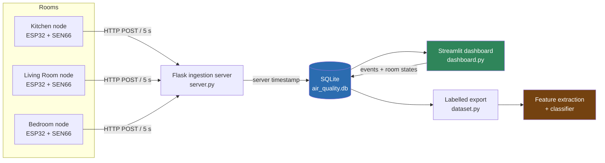

# Indoor Air Quality Source-Event Classification

A three-room indoor air quality monitoring network built around a custom
ESP32 + Sensirion SEN66 PCB, with a labelling and analysis platform for
answering one question:

> **Can a single low-cost multi-channel sensor identify not just *that* air
> quality changed, but *what caused it* — cooking, cleaning, a candle, or
> people entering a room?**

Most consumer monitors report a number and stop there. This project treats
the SEN66's nine channels as a signature and asks which of them actually
carry source information — measured by channel-ablation experiments
(removing and permuting each channel to watch classification accuracy
move), cross-checked against SHAP values. A second question follows from
the three-node layout: how does an event in one room propagate to the
others, and what does that say about transport and ventilation?

**Status:** hardware and data pipeline complete and collecting; labelled
dataset accumulating; classifier and results in progress. Research
findings are being prepared for journal submission and are not published
here yet.

---

## Contents

- [Architecture](#architecture)
- [The dashboard](#the-dashboard)
- [Hardware](#hardware)
- [Repository layout](#repository-layout)
- [Getting started](#getting-started)
- [Data and methods](#data-and-methods)
- [Design decisions worth knowing](#design-decisions-worth-knowing)
- [License](#license)

---

## Architecture

Three identical sensor nodes push readings over WiFi to a local Flask
server, which timestamps and stores them in SQLite. A Streamlit dashboard
reads the same database — for live monitoring, for recording ground-truth
labels, and for exporting the joined dataset that feeds the classifier.



Everything runs on a local machine on the home network — no cloud
dependency, no third-party data handling.

**Why the timestamps come from the server.** Nodes never send their own
clocks. Three ESP32s would drift apart within hours, and a drifting clock
silently corrupts the very thing this project measures: the *lag* between
a kitchen event and a bedroom response. One clock means readings and
labels are exactly joinable.

---

## The dashboard

The dashboard is not an afterthought or a viewer — it is the labelling
instrument. Ground-truth labels are the scarce resource in this kind of
research, and their quality is bounded by how easy they are to record at
the moment something happens. It runs on the local network, so whoever is
actually in the kitchen can log an event from their phone while it is
happening, rather than someone reconstructing it later from memory.

<!-- Add screenshots to docs/screenshots/ and they will render here -->

### Live monitor
Per-room online/stale/offline status and current readings across all nine
channels, so a dead node is caught in minutes rather than at the end of the day.


### Event logging
The labelling interface: start/stop events against their source room, per-room
toggles for window, exhaust fan, purifier, and AC, and retroactive entry for
anything noticed late.


### Analysis and export
Threshold-based event detection, cross-room comparison with lag estimation,
and the labelled dataset export that feeds the classifier.


<!-- Optional: a 30-60s screen recording is the single most convincing artefact here

-->

**Pages**

| Page | What it does |
|---|---|
| Live Monitor | Node health and current readings per room |
| Event Logging | Record events and room-state changes; the labelling instrument |
| Historical Analysis | Long-range trends with hover-to-inspect exact timestamps |
| Room Comparison | Two-room overlay, correlation, and lag estimation for transport analysis |
| Event Analysis | Threshold-based episode detection with per-event summaries |
| Data Export | Raw CSV export, plus the joined labelled dataset for modelling |

---

## Hardware

Each node is a custom PCB carrying an ESP32 and a Sensirion SEN66
environmental sensor.

**Sensor channels (SEN66):** PM1.0, PM2.5, PM4.0, PM10, VOC Index,
NOx Index, CO₂ equivalent, temperature, relative humidity.

| Item | Qty per node | Notes |
|---|---|---|
| ESP32 module | 1 | WiFi MCU |
| Sensirion SEN66 | 1 | Multi-channel environmental sensor, I²C |
| Custom PCB | 1 | See [`hardware/pcb/`](hardware/pcb/) |
| Power supply | 1 | USB |

> Schematic, board files, Gerbers, and the full bill of materials live in
> [`hardware/`](hardware/). Build photos in
> [`hardware/photos/`](hardware/photos/).

**Firmware** is in [`firmware/esp32_node/`](firmware/esp32_node/). Each
node is flashed with the same sketch, with `NODE_ID`, `NODE_NAME`, WiFi
credentials, and the server address set per board. Sampling is every 5 s;
Sensirion's recommended temperature-offset compensation is applied
on-device.

### Room layout

The three-room layout — sensor positions, corridor geometry, door and
window placement, and kitchen exhaust — determines what transport analysis
is possible and is the anchor figure for the paper.


---

## Repository layout

```
├── server.py                 Flask ingestion endpoint (POST /data)
├── dashboard.py              Streamlit entry point
├── config.py                 Rooms, metrics, event types, state types
├── database.py               Sensor-data queries
├── labels.py                 Event + room-state schema and logic
├── dataset.py                The labelled export/join for the classifier
├── metrics.py                Downsampling, statistics, threshold detection
├── plotting.py               Altair charts with hover inspection
├── views/                    One module per dashboard page
├── migrations/               Idempotent schema migrations, run in order
├── tests/                    Unit tests for labelling and join logic
├── tools/                    Utilities (sample dataset generator)
├── firmware/esp32_node/      ESP32 sketch
├── hardware/                 PCB, BOM, build photos
├── docs/                     Figures and dashboard screenshots
└── data/                     Sample dataset and data dictionary
```

---

## Getting started

**Requirements:** Python 3.10+ (developed on 3.14), an ESP32 toolchain for
the firmware.

```bash
py -m pip install -r requirements.txt
```

Apply the schema migrations (safe to re-run; they create tables and
indexes and enable WAL mode):

```bash
py migrations/migrate_add_labels.py
py migrations/migrate_add_logged_at.py
py migrations/migrate_add_ac_state.py
py migrations/migrate_add_sensor_index.py
py migrations/migrate_enable_wal.py
```

Run the ingestion server (creates the database on first run):

```bash
py server.py
```

Run the dashboard in a second terminal:

```bash
py -m streamlit run dashboard.py
```

The dashboard is then reachable at `http://localhost:8501`, and from any
device on the same network at `http://<your-machine-ip>:8501` — which is
how events get logged from the room where they happen.

Run the tests:

```bash
py -m unittest discover -s tests -v
```

---

## Data and methods

A sample slice of real data — four hours, three rooms, two overlapping
labelled cooking events — is in [`data/sample/`](data/sample/), with every
field documented in [`data/DATA_DICTIONARY.md`](data/DATA_DICTIONARY.md).
Calendar dates are shifted to a synthetic epoch; time-of-day and the
sensor values themselves are unmodified.

**Labelling model.** Events are logged once, against their *source* room
only. Room-level conditions (window, exhaust fan, purifier, AC) are logged
as a change history rather than a snapshot. The export then joins each
sensor reading to any overlapping event, tags it `source` or `transport`
depending on whether it is the event's own room, and attaches the
conditions active in that room at that moment via an as-of join.

**Planned analysis.** Windowed feature extraction over the labelled
dataset, then interpretable classifiers (Random Forest / Gradient
Boosting), validated with **leave-one-day-out** cross-validation — not
random k-fold, because readings within a day are strongly correlated and
random splits would leak. The headline experiment is channel ablation:
drop or permute each sensor channel and measure the accuracy cost, to
establish which channels genuinely carry source information rather than
which merely correlate with it.

---

## Design decisions worth knowing

Choices that are load-bearing for data integrity, and the reasoning behind
each:

- **Server-generated timestamps only.** One clock for readings and labels;
  no cross-device drift in the lag measurements.
- **Background rows are kept.** Readings with no event are exported with an
  empty `event_type` rather than dropped — they are the negative class a
  classifier needs to learn what ordinary air looks like.
- **Unknown is not a default.** Before a room's first recorded state
  change, its window/fan/purifier/AC state is exported as `NULL`, never
  assumed. A wrong assumption is worse than an honest gap.
- **Overlapping events duplicate a row rather than dropping a label.**
- **`logged_at` provenance.** Every label records when it was *entered*
  alongside when it *happened*, so retroactively recalled labels remain
  identifiable and their effect can be tested rather than assumed.
- **Detection runs on full-resolution data.** Charts thin points for
  rendering speed, but statistics and event detection always use every
  sample, so no peak is averaged away before it is counted.
- **WAL journal mode.** Readers and writers no longer block each other;
  before this, a long dashboard query could lock the database and cause
  the ingestion server to silently drop sensor readings.

---

## License

[MIT](LICENSE) — free to use, modify, and build on, with attribution.

If this work is useful in your own research, a citation is appreciated.
Findings are being prepared for journal submission; this repository is the
code and hardware companion.
